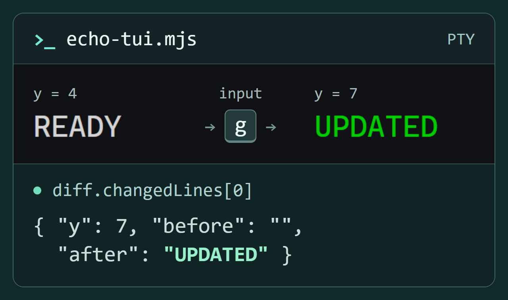

# TuiLens

[](https://www.npmjs.com/package/tuilens)
[](https://github.com/Blackn-L/TuiLens/blob/main/package.json)
[](https://github.com/Blackn-L/TuiLens/actions/workflows/checks.yml?query=branch%3Amain)
[](https://github.com/Blackn-L/TuiLens/blob/main/LICENSE)

**Terminal automation for AI agents and tests.** Run an interactive program in a real pseudoterminal (PTY), send it keys or mouse input, and read the screen it draws. Text observation works without a browser. Request a PNG when you need to check what a user would see.

[简体中文](README.zh-CN.md) · [Documentation](https://blackn-l.github.io/TuiLens/)



The [demo app](https://github.com/Blackn-L/TuiLens/blob/main/examples/echo-tui.mjs) starts at `READY`. Send `g` and it writes `UPDATED` on another line. The [scenario](https://github.com/Blackn-L/TuiLens/blob/main/examples/scenario.json) also tests a drag and captures the result. [Open the example report →](https://blackn-l.github.io/TuiLens/examples/scenario.html)

## Try it in your terminal

Install with Node.js 22 or newer. Then launch Node's interactive prompt from any directory.

```sh
npm install -g tuilens
tuilens launch --cols 64 --rows 8 "--" node -i
```

Copy `data.id` from the launch result and use it in place of `SESSION_ID` below.

```sh
tuilens wait SESSION_ID --text "Welcome to Node.js"
tuilens type SESSION_ID "6 * 7"
tuilens key SESSION_ID Enter
tuilens wait SESSION_ID --text 42
tuilens observe SESSION_ID
tuilens close SESSION_ID
```

The observation contains the typed expression and a separate line with Node's answer, `42`. [Installation and shell examples](docs/GETTING-STARTED.md#cli)

## Choose an interface

| What you want to do | Where to start |
| --- | --- |
| Give an AI agent a terminal it can inspect and operate | [Connect an MCP client](https://blackn-l.github.io/TuiLens/GETTING-STARTED.html#mcp) |
| Reproduce an interaction from a shell or CI job | [Use the JSON CLI](https://blackn-l.github.io/TuiLens/GETTING-STARTED.html#cli) |
| Write assertions in JavaScript or TypeScript | [Import the SDK](https://blackn-l.github.io/TuiLens/GETTING-STARTED.html#sdk) |

## What you can test

- **Interaction.** Find text by region or style, send one action, and wait for the changed screen. A frame diff identifies the rows that changed. [Input, targeting and waits](docs/PROTOCOL.md)
- **Rendering.** Capture a region in character cells and compare its pixels with a reviewed baseline. Terminal profiles can enable SIXEL, iTerm2 inline images or the supported Kitty graphics subset. [Visual comparisons](docs/VISUAL.md) · [Image support](docs/IMAGES.md) · [Terminal profiles](docs/PROFILES.md)
- **Regressions.** Replay recorded terminal output, reproduce a sequence as a scenario, or measure input-to-visible-response latency across rounds. Scenario and performance runs can produce JUnit XML and offline HTML reports. [Recording and scenarios](docs/RECORDING.md) · [Performance](docs/PERFORMANCE.md) · [Reports](docs/REPORTING.md)

> **Status:** experimental, version 0.6.1. Runs on Windows and Linux, with experimental macOS support. Screenshots and visual comparisons require Chrome, Edge or Chromium.

[Contributing](CONTRIBUTING.md) · [Security](SECURITY.md) · [MIT license](LICENSE) · [Third-party licenses](THIRD_PARTY.md)
