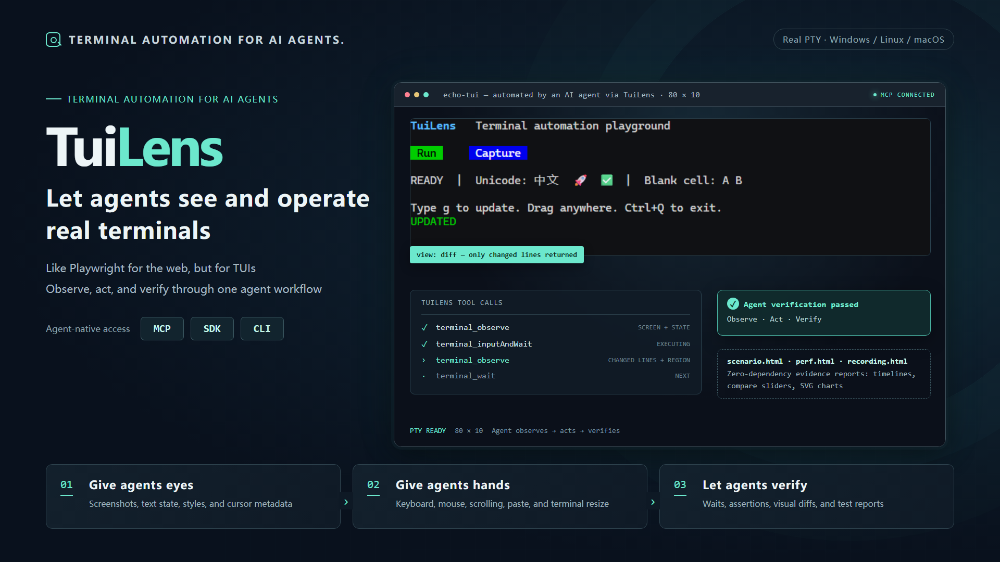

# TuiLens

**Terminal automation for AI agents.**

[English](README.md) · [简体中文](README.zh-CN.md) · [MIT License](LICENSE)

TuiLens runs real terminal applications in a PTY and exposes screenshots, terminal state,
keyboard and mouse input through a JSON CLI, MCP server, and TypeScript SDK.



> **Status:** experimental, version 0.5.5. Text observation runs on a browser-free
> `TerminalCore`; Chromium starts lazily only for visual output.

[Features](#features) · [Installation](#installation) · [Diagnostics](#diagnostics) · [Quick start](#quick-start) · [Interfaces](#interfaces) · [Development](#development) · [Documentation](#documentation) · [License](#license)

## Features

- **Native images:** opt-in SIXEL, iTerm2 OSC 1337 inline images, and a bounded Kitty subset with Unicode virtual placements.
- **Renderer selection:** `headless` is the default. `dom` or `webgl` can be requested eagerly; screenshots, image protocols and visual comparisons activate the browser layer on demand. The actual renderer is returned with every session.
- **Visual testing:** character-region screenshots, PNG comparisons, pixel masks, and inspectable diff artifacts.
- **Interaction:** keys, bracketed paste, clicks, button down/up, drag, wheel coordinates, and modifiers.
- **Recording and replay:** bounded output/input/resize recordings; offline replay never executes recorded input.
- **Reliable targeting:** region and cell-style filters, unique/nth matches, frame or region guards, and conditional waits.
- **Input confirmation:** `input-wait` sends one action, then waits for text, size, stability or cursor evidence.
- **Hit-area control:** `clickText` accepts hitbox/point/offset for the real clickable area beside a label.
- **Pending-frame clicks:** opt in to `allowPendingFrame` when a synchronized frame prevents otherwise safe text targeting.
- **Scroll navigation:** wheel input supports page units and bounded top/bottom navigation in application scrollback.
- **Keyboard protocols:** traditional xterm encoding plus Kitty keyboard protocol (`CSI u`) and `modifyOtherKeys`, so `Shift+Enter`, `Ctrl+Enter` and `Ctrl+Space` reach applications that negotiate them.
- **Terminal profiles:** declarative presets or JSON-derived profiles control `TERM`, DA1/DA2/XTVERSION and Kitty query replies, image protocols, keyboard capability metadata and scrollback. Scenario/perf runs can compare a matrix of profiles.
- **Scrollback assertions:** `observe.scrollback` returns history lines above the viewport, so content that scrolled away can still be asserted.
- **Declarative observation:** `observe --view compact|full|cells|diff` selects the payload shape; `diff --from-frame` returns only changed lines and metadata. Screenshots are opt-in, and `watch` streams compact frames as JSONL.
- **Engine-side probes:** regional text/style waits are evaluated in `TerminalCore`; no browser or full-grid transfer is needed before a match.
- **Terminal reply guard:** late or unmatched DA1/DA2, CPR/DSR and related automatic replies are dropped by default; `suppress` preserves ordinary input.
- **Scenario runner:** declarative steps with failure screenshots, reports, and automatic session cleanup.
- **Performance testing:** declarative multi-round scenarios with setup history growth, process-tree RSS sampling, optional baseline files and regression gating.
- **Test assertions:** a playwright-style `Terminal` handle with expected/actual/screenshot on failure, plus JUnit XML output for CI.
- **Local diagnostics:** `doctor` checks runtime, browser, `node-pty`, storage and daemon state without starting the daemon.
- **Rendering fingerprint:** `probe` renders fixed glyph samples and reports cell metrics, renderer and a stable font/grid fingerprint.
- **Isolation option:** `TUILENS_PTY_WORKER=1` loads `node-pty` in a per-session child process; the default fast path stays in-process.
- **Agent interfaces:** shared CLI/MCP operations and a directly importable SDK.

## Requirements

- Node.js **22 or newer**.
- Windows, Linux, or macOS (experimental). Text-only sessions need no browser; screenshots and image protocols need local Chrome/Chromium or Playwright's Chromium.
- Platform build tools if `node-pty` cannot use a prebuilt binary.

## Installation

TuiLens is currently run from source. After meeting the requirements above:

```sh
git clone https://github.com/Blackn-L/TuiLens.git
cd TuiLens
npm ci
npm run build
```

For visual output, TuiLens detects a system Chrome/Edge installation. Alternatively:

```sh
npx playwright-core install chromium
```

Set `TUILENS_BROWSER_PATH` to select a specific browser executable.
When installing TuiLens as a dependency with npm 12+, allow `node-pty`'s native install script in the
consuming project:

```json
"allowScripts": { "node-pty@1.2.0-beta.18": true }
```

## Diagnostics

Run the local diagnostic check after building:

```sh
node dist/src/interfaces/cli.js doctor
node dist/src/interfaces/cli.js probe
```

It checks Node.js and platform support, browser discovery, `node-pty`, storage permissions,
and daemon state without starting the daemon. The command exits with code 1 when an
error-level check fails; warnings such as stale daemon metadata do not fail the command.
Set `TUILENS_LANG=zh-CN` for Chinese messages.

Set `TUILENS_FONT_FILE` to a `.ttf`, `.otf`, `.woff` or `.woff2` file to pin capture rendering
to a specific font, and `TUILENS_FONT_FAMILY` to override the fallback stack. Restart the
daemon after changing either value. `snapshot.render.fontHash` identifies an embedded font,
and `probe --font-file <path> --strict-font` checks that circled numerals keep one glyph scale.
The default renderer injects circled-numeral-only local faces from `Noto Sans`, `MS PGothic`,
`Segoe UI Symbol`, and `Apple Symbols`; this prevents Windows from switching `⓪` and
`⑪`–`⑳` to Consolas's smaller glyphs without changing the main ASCII/CJK font selection.

## Quick start

Inspect the CLI:

```sh
node dist/src/interfaces/cli.js --help
```

Run the self-contained scenario from the repository root:

```sh
node dist/src/interfaces/cli.js scenario --file examples/scenario.json
```

The JSON result contains a report path and step artifacts. A failed scenario or visual comparison exits with code 1.

For an interactive session:

```sh
node dist/src/interfaces/cli.js launch --record --cols 80 --rows 16 -- node examples/echo-tui.mjs
```

Select a terminal identity with `--terminal-profile kitty`, `wezterm`, `iterm2`, or a JSON profile path.
See [terminal profiles](docs/PROFILES.md) for all presets, inheritance and matrix examples.

Copy the returned `data.id` into the commands below:

```sh
node dist/src/interfaces/cli.js observe SESSION_ID
node dist/src/interfaces/cli.js type SESSION_ID g
node dist/src/interfaces/cli.js wait SESSION_ID --text UPDATED
node dist/src/interfaces/cli.js input-wait SESSION_ID PING --text INPUT_RECEIVED
node dist/src/interfaces/cli.js drag SESSION_ID 2 3 20 3 --shift
node dist/src/interfaces/cli.js observe SESSION_ID --region 0,7,30,4
node dist/src/interfaces/cli.js key SESSION_ID Ctrl+q
node dist/src/interfaces/cli.js wait SESSION_ID --exited
node dist/src/interfaces/cli.js close SESSION_ID
node dist/src/interfaces/cli.js shutdown
```

`SESSION_ID` is a placeholder for the returned UUID. Coordinates are **zero-based character cells**.
Plain input confirms delivery only; use `input-wait` or an explicit wait for a rendered result. Input is never retried automatically.
Automatic terminal replies default to `--protocol-replies auto`: only timely, query-matched known replies are forwarded.
If an application probes while its TTY already echoes, use `--protocol-replies suppress` or the application's own probe switch.

## Interfaces

All interfaces share the same PTY engine and session state. Use the smallest surface that fits the caller.

| Surface | Best for | Entry point | Details |
| --- | --- | --- | --- |
| CLI | Shell scripts, CI jobs, and manual probes | `node dist/src/interfaces/cli.js <command>` | [Quick start](#quick-start) · [Protocol examples](docs/PROTOCOL.md) |
| MCP | Agents that need tool calls and image content | `node /absolute/path/to/TuiLens/dist/src/interfaces/cli.js mcp` over stdio | [MCP client setup](docs/MCP-SETUP.md) |
| TypeScript SDK | Test suites and embedded automation | `import { SessionManager, terminal } from "./dist/src/index.js"` | [Testing API](#testing-api) · [SDK example](#typescript-sdk) |

## Language

CLI help, MCP tool descriptions, errors and assertion messages default to English.
Set `TUILENS_LANG=zh-CN` for Simplified Chinese:

```powershell
$env:TUILENS_LANG = "zh-CN"
```

```sh
export TUILENS_LANG=zh-CN
```

`TUILENS_LANG` accepts `en`, `zh` and `zh-CN` case-insensitively; unsupported values
fall back to English. Set it in the MCP client's environment to localize tool descriptions
and error responses for that connection. Structured errors from CLI, MCP and the SDK expose
both `messageEn` and `messageZh`; `message` follows the active locale.

## Images and screenshots

Image protocols are capabilities of the selected terminal profile. Use a preset such as
`launch --terminal-profile kitty`, or provide explicit `graphics` in JSON launch options:

```json
{ "command": "my-tui", "graphics": { "sixel": true, "kitty": true, "iterm": true } }
```

Images are **off by default**. The flags enable only the implemented families; they do not claim full
Kitty or OSC 1337 extension conformance. Enabling any image protocol activates `VisualRenderer`.

`launch --renderer webgl` eagerly enables xterm.js's WebGL renderer. The default is `headless`; a normal
`observe` without a screenshot does not start Chromium. WebGL is recommended when block/box-drawing glyphs
must be continuous in captured PNGs. It may round the cell width (for example, 160 columns can change from
1500px to 1440px), so re-record visual baselines when switching.
`session.renderer`, scenario/perf environments, observation JSON and comparison JSON contain live renderer
state; recording headers contain the renderer at recording start. If WebGL cannot start, TuiLens falls back to DOM and reports `dom` rather than
silently claiming WebGL. A session can start as `headless` and report `dom` after its first screenshot;
`visualSyncDegraded` is set if the bounded replay window discarded history needed to reconstruct the screen.

```sh
node dist/src/interfaces/cli.js observe SESSION_ID --screenshot --region 0,0,40,10
node dist/src/interfaces/cli.js observe SESSION_ID --view cells
node dist/src/interfaces/cli.js observe SESSION_ID --view diff --from-frame 42
node dist/src/interfaces/cli.js compare SESSION_ID --baseline baseline.png --region 0,0,40,10
```

A screenshot and its state share a `frameId`. Region capture crops the PNG; terminal state still describes
the full viewport. `compact` is the default; `full` skips compact line trimming, `cells` adds the full cell grid,
and `diff` compares against one of the retained 16 lightweight frame snapshots. Complete capture metadata is also saved locally.
Baselines are read-only: accept a new baseline explicitly by copying a reviewed screenshot.
Comparison masks use **PNG pixels**, not character cells. Fix fonts, browser version and grid dimensions for reproducible diffs.

See [image support](docs/IMAGES.md) and [visual comparisons](docs/VISUAL.md) for exact limits.

## Targeting and waiting

```sh
node dist/src/interfaces/cli.js find SESSION_ID Run --unique
node dist/src/interfaces/cli.js click-text SESSION_ID Run --nth 1
node dist/src/interfaces/cli.js click-text --json '{"id":"SESSION_ID","text":"Collapse","options":{"hitbox":{"right":3},"point":"right"}}'
node dist/src/interfaces/cli.js wait SESSION_ID --stable 250 --region 0,0,40,10
```

`click-text` requires a unique match unless a selection is explicit. Finding text does not imply a business control.
Use `hitbox`/`point`/`offset` to target padding or an arrow beside the label, and optionally specify the mouse button.
The JSON interface additionally supports `style`, `count`, `afterFrameId`, and input guards.
A region fingerprint rejects a changed target while allowing unrelated animation elsewhere.
For a synchronized output frame that never closes, set `options.allowPendingFrame:true` explicitly on `clickText`.
It reads the pending character buffer and retains the target-region fingerprint check. It does not provide a stable screenshot
or bypass `frameId` guards. Ordinary observation and screenshots still require the frame to finish.

```json
{ "type": "scroll", "x": 20, "y": 10, "direction": "down", "unit": "page", "amount": 5 }
{ "type": "scroll", "x": 20, "y": 10, "to": "top" }
```

Scroll coordinates select the hovered application region. Page units expand to terminal rows;
top/bottom use bounded wheel-event sequences, so application-specific line consumption and scrollback limits still apply.
`amount` remains capped at 100 per call. Use explicit drag operations for a scrollbar that requires dragging.

All commands accept `--json`, `--file`, or `--stdin` for structured parameters.
See [protocol examples](docs/PROTOCOL.md).

## Recording and scenarios

`launch --record` records from the first processed output. Its result includes `recordingPath`.
Recordings contain terminal output and input content; use them only when appropriate for the session data.
The default cap is 16 MiB, configurable between 4 KiB and 64 MiB. Truncated recordings are explicitly marked.

```sh
node dist/src/interfaces/cli.js replay path/to/session.recording.jsonl
node dist/src/interfaces/cli.js replay path/to/session.recording.jsonl --speed 2
```

Replay applies output and resize events to a fresh engine. It does not rerun the application,
commands, or recorded input. `speed=0` applies events immediately. Truncated replay requires `--allow-truncated`.

[Scenario example](examples/scenario.json) · [recording and scenario semantics](docs/RECORDING.md)

## Performance testing

TUI agents accumulate conversation history, so response time tends to degrade over long sessions.
`perf` runs a fixed workload across restart-isolated rounds and can compare the result with a baseline you
generate for your application. The TuiLens repository does not ship a baseline: measurements depend on the
application, platform, grid and runner.

```sh
# Generate a baseline for your workload. The path is yours to choose.
node dist/src/interfaces/cli.js perf --file examples/perf.json --write-baseline artifacts/perf-baseline.json

# Later runs can compare against it.
node dist/src/interfaces/cli.js perf --file examples/perf.json \
  --baseline artifacts/perf-baseline.json --max-regression 0.15 --junit artifacts/junit-perf.xml
```

Use a tracked path in your own repository if you want the baseline to gate CI; `artifacts/` is for local
or demonstration runs and is ignored by Git.

Each round restarts the application, so in-process state cannot leak between rounds. Every measurement is
"input sent → evidence visible", which is the latency a user actually feels. `setup` steps rebuild state (for
example 40 turns of history) before a phase is measured, and `{{seq}}` expands to the running input counter so
every sample waits for *its own* new evidence instead of matching text that already existed.

```json
{
  "version": 1,
  "launch": { "command": "node", "args": ["examples/perf-tui.mjs"], "cols": 80, "rows": 24 },
  "ready": [{ "kind": "text", "text": "TURN_0" }],
  "warmupRounds": 1, "rounds": 3, "repeats": 3,
  "phases": [{
    "name": "short-history",
    "samples": [{ "input": { "type": "text", "text": "x" },
      "observe": [{ "kind": "text", "text": "TURN_{{seq}}" }] }]
  }]
}
```

Results include per-phase p50/p95/p99, a stability verdict (max ÷ p50), the application's **process-tree** peak RSS
(not just the tool's), and per-metric comparison when a baseline is supplied. When a baseline is supplied,
a p50 increase beyond `--max-regression` fails the run with a nonzero exit status.

Baselines are optional measurement snapshots, not required configuration. They record the platform and grid;
comparing across a different environment is refused unless you pass `--allow-env-mismatch`. Measurement
boundaries are documented in [performance](docs/PERFORMANCE.md).

## Testing API

The SDK exposes a playwright-style handle for test files:

```ts
import { SessionManager, terminal } from "./dist/src/index.js";

const manager = new SessionManager({ artifactDir: "./artifacts" });
const tui = await terminal(manager, { command: "my-tui", cols: 100, rows: 30 });
await tui.expectText("Ready");
await tui.type("hello");
await tui.key("Shift+Enter");           // requires the application to negotiate CSI u
await tui.expectText("Response", { timeoutMs: 10_000 });
await tui.expectNoText("Error", { timeoutMs: 500 });
```

`expectNoText` waits the full window before passing: text that has simply not rendered yet must not be reported
as absent. A failed assertion carries `expected`, `actual`, a screenshot path and a screen excerpt.

Scenarios and performance runs can emit JUnit XML with `--junit <path>` for CI reporting.

## MCP

Build TuiLens first, then configure your MCP client to launch this stdio server using an
**absolute path**:

```json
{
  "mcpServers": {
    "tuilens": {
      "command": "node",
      "args": ["/absolute/path/to/TuiLens/dist/src/interfaces/cli.js", "mcp"]
    }
  }
}
```

See [MCP client setup](docs/MCP-SETUP.md) for source installation, Codex and JSON client
configuration, verification, troubleshooting, and local-only security notes.

The server also publishes MCP initialization instructions that tell agents to prefer TuiLens
for interactive TUI work, alongside task-oriented tool descriptions. Clients that support
server instructions read them automatically; add a client-level rule or skill when a specific
agent still needs deterministic routing.

Available tools: `terminal_launch`, `terminal_list`, `terminal_observe`, `terminal_find`,
`terminal_clickText`, `terminal_input`, `terminal_inputAndWait`, `terminal_resize`, `terminal_wait`, `terminal_compare`,
`terminal_replay`, `terminal_scenario`, `terminal_perf`, `terminal_metrics`, and `terminal_close`.
`terminal_observe`, `terminal_replay`, and screenshot-enabled `terminal_inputAndWait` return PNG image content as well as text metadata.
Disconnecting releases sessions created by that MCP connection.
Long-running wait, inputAndWait, replay, scenario and perf calls emit progress heartbeats when the client
requests a progress token; cancelling the MCP request aborts the matching daemon operation.

## TypeScript SDK

```ts
import { SessionManager } from "./dist/src/index.js";

const manager = new SessionManager({ artifactDir: "./artifacts", ptyWorker: false });
try {
  const session = await manager.launch({
    command: "node", args: ["examples/echo-tui.mjs"], cols: 80, rows: 16,
  });
  await manager.wait(session.id, { conditions: [{ kind: "text", text: "READY" }] });
  await manager.input(session.id, { type: "text", text: "g" });
  await manager.wait(session.id, { conditions: [{ kind: "text", text: "UPDATED" }] });
  console.log((await manager.observe(session.id)).screenshot?.path);
} finally {
  await manager.closeAll();
}
```

## Development

```sh
npm run check
npm run lint
npm run format:check
npm test
npm run test:coverage
npm run smoke:install
npm run soak
npm run benchmark:overhead -- --frames 120 --repeats 3 --pace-ms 1
```

Tests use independent fixtures. Generated captures, recordings, reports, and build outputs are ignored by Git.
The daemon uses a local named pipe on Windows, an abstract Unix socket on Linux and a private Unix socket on macOS,
using persistent IPC v2 connections authenticated by a local token. One connection multiplexes requests,
streams `watch` frames and real `scenario`/`perf` progress, and enforces 64 in-flight requests per connection.
`TUILENS_IPC_TIMEOUT_MS` optionally sets an IPC timeout; no fixed five-minute cap is applied by default.
Set `TUILENS_HOME` to isolate its state directory (default: `~/.tuilens`). No public HTTP control server is exposed.

## Documentation

| Topic | English | 简体中文 |
| --- | --- | --- |
| Architecture | [ARCHITECTURE.md](docs/ARCHITECTURE.md) | [架构](docs/zh-CN/ARCHITECTURE.md) |
| MCP setup | [MCP-SETUP.md](docs/MCP-SETUP.md) | [MCP 接入](docs/zh-CN/MCP-SETUP.md) |
| Protocol | [PROTOCOL.md](docs/PROTOCOL.md) | [协议示例](docs/zh-CN/PROTOCOL.md) |
| Terminal profiles | [PROFILES.md](docs/PROFILES.md) | [终端能力画像](docs/zh-CN/PROFILES.md) |
| Recording and scenarios | [RECORDING.md](docs/RECORDING.md) | [录制与场景](docs/zh-CN/RECORDING.md) |
| Images | [IMAGES.md](docs/IMAGES.md) | [图片支持](docs/zh-CN/IMAGES.md) |
| Visual comparisons | [VISUAL.md](docs/VISUAL.md) | [视觉比较](docs/zh-CN/VISUAL.md) |
| Validation | [VALIDATION.md](docs/VALIDATION.md) | [验证](docs/zh-CN/VALIDATION.md) |
| Performance | [PERFORMANCE.md](docs/PERFORMANCE.md) | [性能](docs/zh-CN/PERFORMANCE.md) |
| Releasing | [RELEASING.md](docs/RELEASING.md) | [发布](docs/zh-CN/RELEASING.md) |
| Roadmap | [ROADMAP.md](docs/ROADMAP.md) | [路线](docs/zh-CN/ROADMAP.md) |

## Limitations

- Kitty support is a documented subset; no external-file/shared-memory transport, animation, compression, or arbitrary layers.
- Mouse input requires character-based SGR mode. System IME windows and system clipboard behavior are outside this renderer.
- Screenshots hide the cursor by default; snapshots still expose visibility, style and blink, but real host cursor and IME behavior cannot be verified.
- `protocolReplies: "auto"` forwards only timely, query-matched known replies. `suppress` drops only recognized complete replies, not arbitrary input. If an app probes while its TTY already echoes, use `suppress` or an app-side probe switch.
- Browser parsing, rendering, capture and recording have overhead. `metrics` is lightweight, but does not remove the renderer's cost.
- `doctor` checks module loading, paths and daemon metadata; it does not launch a browser or PTY. Use a real session and the test suite for runtime verification.
- `watch` is read-only by default; `--control` forwards terminal input and requires an interactive TTY. `probe` only represents the current font, browser and platform.
- `TUILENS_PTY_WORKER=1` adds an IPC hop and is not a security sandbox.
- Replay reproduces output, not application behavior. Stable regions do not prove an application has finished all work.
- Windows `node-pty 1.2.0-beta.18` may print `AttachConsole failed` during cleanup; verify process termination and retain diagnostics.

## License

TuiLens is released under the [MIT License](LICENSE). Copyright (c) 2026 Blackn-L.

Third-party components retain their own licenses; see [THIRD_PARTY.md](THIRD_PARTY.md).

## Contributing

Read [CONTRIBUTING.md](CONTRIBUTING.md), use focused fixtures, and include reproduction and validation evidence.
For security reports, see [SECURITY.md](SECURITY.md).
