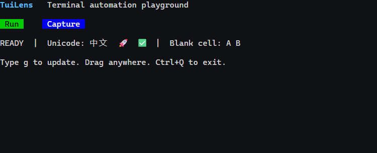

# TuiLens

**Terminal automation for AI agents.**

[English](README.md) · [简体中文](README.zh-CN.md)

TuiLens runs real terminal applications in a PTY and exposes screenshots, terminal state,
keyboard and mouse input through a JSON CLI, MCP server, and TypeScript SDK.



> **Status:** experimental, version 0.4.0. Designed for functional and visual testing.
> The browser renderer is not a low-overhead performance measurement environment.

## Features

- **Native images:** opt-in SIXEL, iTerm2 OSC 1337 inline images, and a bounded Kitty subset with Unicode virtual placements.
- **Visual testing:** character-region screenshots, PNG comparisons, pixel masks, and inspectable diff artifacts.
- **Interaction:** keys, bracketed paste, clicks, button down/up, drag, wheel coordinates, and modifiers.
- **Recording and replay:** bounded output/input/resize recordings; offline replay never executes recorded input.
- **Reliable targeting:** region and cell-style filters, unique/nth matches, frame or region guards, and conditional waits.
- **Input confirmation:** `input-wait` sends one action, then waits for text, size, stability or cursor evidence.
- **Hit-area control:** `clickText` accepts hitbox/point/offset for the real clickable area beside a label.
- **Pending-frame clicks:** opt in to `allowPendingFrame` when a synchronized frame prevents otherwise safe text targeting.
- **Scroll navigation:** wheel input supports page units and bounded top/bottom navigation in application scrollback.
- **Keyboard protocols:** traditional xterm encoding plus Kitty keyboard protocol (`CSI u`) and `modifyOtherKeys`, so `Shift+Enter`, `Ctrl+Enter` and `Ctrl+Space` reach applications that negotiate them.
- **Scrollback assertions:** `observe.scrollback` returns history lines above the viewport, so content that scrolled away can still be asserted.
- **Terminal reply guard:** late or unmatched DA1/DA2, CPR/DSR and related automatic replies are dropped by default; `suppress` preserves ordinary input.
- **Scenario runner:** declarative steps with failure screenshots, reports, and automatic session cleanup.
- **Performance testing:** declarative multi-round scenarios with setup history growth, process-tree RSS sampling, optional baseline files and regression gating.
- **Test assertions:** a playwright-style `Terminal` handle with expected/actual/screenshot on failure, plus JUnit XML output for CI.
- **Agent interfaces:** shared CLI/MCP operations and a directly importable SDK.

## Requirements

- Node.js **22 or newer**.
- Windows or Linux; a local Chrome/Chromium installation or Playwright's Chromium.
- Platform build tools if `node-pty` cannot use a prebuilt binary.

## Quick start

```sh
git clone https://github.com/Blackn-L/TuiLens.git
cd TuiLens
npm ci
npm run build
node dist/src/interfaces/cli.js --help
```

TuiLens detects a system Chrome/Edge installation. Alternatively:

```sh
npx playwright install chromium
```

Set `TUILENS_BROWSER_PATH` to select a specific browser executable.
Run the self-contained scenario from the repository root:

```sh
node dist/src/interfaces/cli.js scenario --file examples/scenario.json
```

The JSON result contains a report path and step artifacts. A failed scenario or visual comparison exits with code 1.

For an interactive session:

```sh
node dist/src/interfaces/cli.js launch --record --cols 80 --rows 16 -- node examples/echo-tui.mjs
```

Copy the returned `data.id` into the commands below:

```sh
node dist/src/interfaces/cli.js observe SESSION_ID
node dist/src/interfaces/cli.js type SESSION_ID g
node dist/src/interfaces/cli.js wait SESSION_ID --text UPDATED
node dist/src/interfaces/cli.js input-wait SESSION_ID PING --text INPUT_RECEIVED
node dist/src/interfaces/cli.js drag SESSION_ID 2 3 20 3 --shift
node dist/src/interfaces/cli.js observe SESSION_ID --region 0,7,30,4
node dist/src/interfaces/cli.js key SESSION_ID Ctrl+q
node dist/src/interfaces/cli.js wait SESSION_ID --exited
node dist/src/interfaces/cli.js close SESSION_ID
node dist/src/interfaces/cli.js shutdown
```

`SESSION_ID` is a placeholder for the returned UUID. Coordinates are **zero-based character cells**.
Plain input confirms delivery only; use `input-wait` or an explicit wait for a rendered result. Input is never retried automatically.
Automatic terminal replies default to `--protocol-replies auto`: only timely, query-matched known replies are forwarded.
If an application probes while its TTY already echoes, use `--protocol-replies suppress` or the application's own probe switch.

## Images and screenshots

Use `launch --images sixel`, `launch --images iterm`, or `launch --images all`. Images are **off by default**.
`iterm` enables OSC 1337 inline images, including multipart transport. `all` enables all three implemented
image families; it does not mean full Kitty or OSC 1337 extension conformance.

```sh
node dist/src/interfaces/cli.js observe SESSION_ID --region 0,0,40,10
node dist/src/interfaces/cli.js compare SESSION_ID --baseline baseline.png --region 0,0,40,10
```

A screenshot and its state share a `frameId`. Region capture crops the PNG; terminal state still describes
the full viewport. `--cells` includes the full cell grid in CLI output. Complete capture metadata is also saved locally.
Baselines are read-only: accept a new baseline explicitly by copying a reviewed screenshot.
Comparison masks use **PNG pixels**, not character cells. Fix fonts, browser version and grid dimensions for reproducible diffs.

See [image support](docs/IMAGES.md) and [visual comparisons](docs/VISUAL.md) for exact limits.

## Targeting and waiting

```sh
node dist/src/interfaces/cli.js find SESSION_ID Run --unique
node dist/src/interfaces/cli.js click-text SESSION_ID Run --nth 1
node dist/src/interfaces/cli.js click-text --json '{"id":"SESSION_ID","text":"Collapse","options":{"hitbox":{"right":3},"point":"right"}}'
node dist/src/interfaces/cli.js wait SESSION_ID --stable 250 --region 0,0,40,10
```

`click-text` requires a unique match unless a selection is explicit. Finding text does not imply a business control.
Use `hitbox`/`point`/`offset` to target padding or an arrow beside the label, and optionally specify the mouse button.
The JSON interface additionally supports `style`, `count`, `afterFrameId`, and input guards.
A region fingerprint rejects a changed target while allowing unrelated animation elsewhere.
For a synchronized output frame that never closes, set `options.allowPendingFrame:true` explicitly on `clickText`.
It reads the pending character buffer and retains the target-region fingerprint check. It does not provide a stable screenshot
or bypass `frameId` guards. Ordinary observation and screenshots still require the frame to finish.

```json
{ "type": "scroll", "x": 20, "y": 10, "direction": "down", "unit": "page", "amount": 5 }
{ "type": "scroll", "x": 20, "y": 10, "to": "top" }
```

Scroll coordinates select the hovered application region. Page units expand to terminal rows;
top/bottom use bounded wheel-event sequences, so application-specific line consumption and scrollback limits still apply.
`amount` remains capped at 100 per call. Use explicit drag operations for a scrollbar that requires dragging.

All commands accept `--json`, `--file`, or `--stdin` for structured parameters.
See [protocol examples](docs/PROTOCOL.md).

## Recording and scenarios

`launch --record` records from the first processed output. Its result includes `recordingPath`.
Recordings contain terminal output and input content; use them only when appropriate for the session data.
The default cap is 16 MiB, configurable between 4 KiB and 64 MiB. Truncated recordings are explicitly marked.

```sh
node dist/src/interfaces/cli.js replay path/to/session.recording.jsonl
node dist/src/interfaces/cli.js replay path/to/session.recording.jsonl --speed 2
```

Replay applies output and resize events to a fresh engine. It does not rerun the application,
commands, or recorded input. `speed=0` applies events immediately. Truncated replay requires `--allow-truncated`.

[Scenario example](examples/scenario.json) · [recording and scenario semantics](docs/RECORDING.md)

## Performance testing

TUI agents accumulate conversation history, so response time tends to degrade over long sessions.
`perf` runs a fixed workload across restart-isolated rounds and can compare the result with a baseline you
generate for your application. The TuiLens repository does not ship a baseline: measurements depend on the
application, platform, grid and runner.

```sh
# Generate a baseline for your workload. The path is yours to choose.
node dist/src/interfaces/cli.js perf --file examples/perf.json --write-baseline artifacts/perf-baseline.json

# Later runs can compare against it.
node dist/src/interfaces/cli.js perf --file examples/perf.json \
  --baseline artifacts/perf-baseline.json --max-regression 0.15 --junit artifacts/junit-perf.xml
```

Use a tracked path in your own repository if you want the baseline to gate CI; `artifacts/` is for local
or demonstration runs and is ignored by Git.

Each round restarts the application, so in-process state cannot leak between rounds. Every measurement is
"input sent → evidence visible", which is the latency a user actually feels. `setup` steps rebuild state (for
example 40 turns of history) before a phase is measured, and `{{seq}}` expands to the running input counter so
every sample waits for *its own* new evidence instead of matching text that already existed.

```json
{
  "version": 1,
  "launch": { "command": "node", "args": ["examples/perf-tui.mjs"], "cols": 80, "rows": 24 },
  "ready": [{ "kind": "text", "text": "TURN_0" }],
  "warmupRounds": 1, "rounds": 3, "repeats": 3,
  "phases": [{
    "name": "short-history",
    "samples": [{ "input": { "type": "text", "text": "x" },
      "observe": [{ "kind": "text", "text": "TURN_{{seq}}" }] }]
  }]
}
```

Results include per-phase p50/p95/p99, a stability verdict (max ÷ p50), the application's **process-tree** peak RSS
(not just the tool's), and per-metric comparison when a baseline is supplied. When a baseline is supplied,
a p50 increase beyond `--max-regression` fails the run with a nonzero exit status.

Baselines are optional measurement snapshots, not required configuration. They record the platform and grid;
comparing across a different environment is refused unless you pass `--allow-env-mismatch`. Measurement
boundaries are documented in [performance](docs/PERFORMANCE.md).

## Testing API

The SDK exposes a playwright-style handle for test files:

```ts
import { SessionManager, terminal } from "tuilens";

const manager = new SessionManager({ artifactDir: "./artifacts" });
const tui = await terminal(manager, { command: "my-tui", cols: 100, rows: 30 });
await tui.expectText("Ready");
await tui.type("hello");
await tui.key("Shift+Enter");           // requires the application to negotiate CSI u
await tui.expectText("Response", { timeoutMs: 10_000 });
await tui.expectNoText("Error", { timeoutMs: 500 });
```

`expectNoText` waits the full window before passing: text that has simply not rendered yet must not be reported
as absent. A failed assertion carries `expected`, `actual`, a screenshot path and a screen excerpt.

Scenarios and performance runs can emit JUnit XML with `--junit <path>` for CI reporting.

## MCP

Configure your MCP client to launch this stdio server, using an **absolute path**:

```json
{
  "mcpServers": {
    "tuilens": {
      "command": "node",
      "args": ["/absolute/path/to/TuiLens/dist/src/interfaces/cli.js", "mcp"]
    }
  }
}
```

Available tools: `terminal_launch`, `terminal_list`, `terminal_observe`, `terminal_find`,
`terminal_clickText`, `terminal_input`, `terminal_inputAndWait`, `terminal_resize`, `terminal_wait`, `terminal_compare`,
`terminal_replay`, `terminal_scenario`, `terminal_metrics`, and `terminal_close`.
`terminal_observe`, `terminal_replay`, and screenshot-enabled `terminal_inputAndWait` return PNG image content as well as text metadata.
Disconnecting releases sessions created by that MCP connection.

## TypeScript SDK

```ts
import { SessionManager } from "./dist/src/index.js";

const manager = new SessionManager({ artifactDir: "./artifacts" });
try {
  const session = await manager.launch({
    command: "node", args: ["examples/echo-tui.mjs"], cols: 80, rows: 16,
  });
  await manager.wait(session.id, { conditions: [{ kind: "text", text: "READY" }] });
  await manager.input(session.id, { type: "text", text: "g" });
  await manager.wait(session.id, { conditions: [{ kind: "text", text: "UPDATED" }] });
  console.log((await manager.observe(session.id)).screenshot?.path);
} finally {
  await manager.closeAll();
}
```

## Development

```sh
npm run check
npm test
npm run benchmark:overhead -- --frames 120 --repeats 3 --pace-ms 1
```

Tests use independent fixtures. Generated captures, recordings, reports, and build outputs are ignored by Git.
The daemon uses a local named pipe on Windows and an abstract Unix socket on Linux, authenticated by a local token.
Set `TUILENS_HOME` to isolate its state directory (default: `~/.tuilens`). No public HTTP control server is exposed.

[Architecture](docs/ARCHITECTURE.md) · [Validation](docs/VALIDATION.md) · [Performance](docs/PERFORMANCE.md) · [Roadmap](docs/ROADMAP.md)

## Limitations

- Kitty support is a documented subset; no external-file/shared-memory transport, animation, compression, or arbitrary layers.
- Mouse input requires character-based SGR mode. System IME windows and system clipboard behavior are outside this renderer.
- Screenshots hide the cursor by default; snapshots still expose visibility, style and blink, but real host cursor and IME behavior cannot be verified.
- `protocolReplies: "auto"` forwards only timely, query-matched known replies. `suppress` drops only recognized complete replies, not arbitrary input. If an app probes while its TTY already echoes, use `suppress` or an app-side probe switch.
- Browser parsing, rendering, capture and recording have overhead. `metrics` is lightweight, but does not remove the renderer's cost.
- Replay reproduces output, not application behavior. Stable regions do not prove an application has finished all work.
- Windows `node-pty 1.1.0` may print `AttachConsole failed` during cleanup; verify process termination and retain diagnostics.
- No project-wide open-source license has been selected yet. Public visibility does not grant an additional redistribution license.
  Third-party components retain their own licenses; see [THIRD_PARTY.md](THIRD_PARTY.md).

## Contributing

Read [CONTRIBUTING.md](CONTRIBUTING.md), use focused fixtures, and include reproduction and validation evidence.
For security reports, see [SECURITY.md](SECURITY.md).
