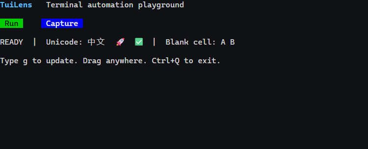

# TuiLens

**面向 AI Agent 的终端自动化工具。**

[English](README.md) · [简体中文](README.zh-CN.md)

TuiLens 在真实 PTY 中运行终端程序，通过 JSON CLI、MCP 和 TypeScript SDK
提供截图、终端状态、键盘与鼠标输入。



> **状态：** 0.4.0 实验版本，用于功能和视觉测试。
> 浏览器渲染链路不属于低干扰性能测量环境。

## 功能

- **原生图片：** 按需启用 SIXEL、iTerm2 OSC 1337 内联图片和有界 Kitty 子集，支持 Unicode 虚拟放置。
- **视觉测试：** 字符格区域截图、PNG 比较、像素遮罩、差异图与报告。
- **输入操作：** 按键、括号粘贴、点击、按住/释放、拖拽、带位置滚轮和修饰键。
- **录制回放：** 有容量限制的输出/输入/resize 记录；离线回放不执行录制的输入。
- **可靠定位：** 区域和样式筛选、唯一/nth 匹配、帧或区域保护、组合条件等待。
- **交互确认：** `input-wait` 发送一次输入后等待可见结果，支持文本、尺寸、稳定和光标条件。
- **命中区控制：** `clickText` 可用 hitbox/point/offset 指定文字旁的真实可点击区域。
- **终端应答护栏：** 默认丢弃超时或无查询匹配的 DA1/DA2、CPR/DSR 等自动应答。
- **场景执行：** 声明式步骤、失败截图、报告和自动清理。
- **Agent 接口：** CLI/MCP 共用接口，同时提供 SDK。

## 环境要求

- Node.js **22 或更高版本**。
- Windows 或 Linux，以及本机 Chrome/Chromium 或 Playwright Chromium。
- node-pty 无可用预编译包时，需要相应平台的 C++ 构建工具。

## 快速开始

```sh
git clone https://github.com/Blackn-L/TuiLens.git
cd TuiLens
npm ci
npm run build
node dist/src/interfaces/cli.js --help
```

默认检测系统 Chrome/Edge；也可以安装 Playwright Chromium：

```sh
npx playwright install chromium
```

通过 `TUILENS_BROWSER_PATH` 指定浏览器。仓库根目录可直接运行独立场景：

```sh
node dist/src/interfaces/cli.js scenario --file examples/scenario.json
```

JSON 结果包含报告路径和步骤证据。场景或视觉比较失败时退出码为 1。

启动交互会话：

```sh
node dist/src/interfaces/cli.js launch --record --cols 80 --rows 16 -- node examples/echo-tui.mjs
```

将返回的 `data.id` 替换到下面的 `SESSION_ID`：

```sh
node dist/src/interfaces/cli.js observe SESSION_ID
node dist/src/interfaces/cli.js type SESSION_ID g
node dist/src/interfaces/cli.js wait SESSION_ID --text UPDATED
node dist/src/interfaces/cli.js input-wait SESSION_ID PING --text INPUT_RECEIVED
node dist/src/interfaces/cli.js drag SESSION_ID 2 3 20 3 --shift
node dist/src/interfaces/cli.js observe SESSION_ID --region 0,7,30,4
node dist/src/interfaces/cli.js key SESSION_ID Ctrl+q
node dist/src/interfaces/cli.js wait SESSION_ID --exited
node dist/src/interfaces/cli.js close SESSION_ID
node dist/src/interfaces/cli.js shutdown
```

坐标从 **0** 起算，单位为字符格。普通输入返回表示已送达；需要确认渲染结果时使用
`input-wait` 或显式等待。它不会自动重发输入。
终端自动应答默认使用 `--protocol-replies auto`，只转发及时且存在查询匹配的已知应答。
若应用在 TTY 已回显时查询，使用 `--protocol-replies suppress` 或应用侧探测开关。

## 图片与截图

使用 `launch --images sixel`、`launch --images iterm` 或 `launch --images all`，默认 `off`。
`iterm` 启用 OSC 1337 内联图片及分段传输。`all` 包含三种已实现的图片协议，
不代表完整 Kitty 或 OSC 1337 扩展兼容。

```sh
node dist/src/interfaces/cli.js observe SESSION_ID --region 0,0,40,10
node dist/src/interfaces/cli.js compare SESSION_ID --baseline baseline.png --region 0,0,40,10
```

截图和状态共享 `frameId`。区域裁剪只改变 PNG，状态仍包含完整视口。
`--cells` 可额外返回完整字符格；完整截图元数据也保存在本地。
基准图只读，接受新基准必须显式复制已审查的截图。
比较遮罩以 **PNG 像素**计量，与字符格坐标不同。请固定字体、浏览器和网格以解释像素差异。

详见[图片支持](docs/zh-CN/IMAGES.md)和[视觉比较](docs/zh-CN/VISUAL.md)。

## 定位与等待

```sh
node dist/src/interfaces/cli.js find SESSION_ID Run --unique
node dist/src/interfaces/cli.js click-text SESSION_ID Run --nth 1
node dist/src/interfaces/cli.js click-text --json '{"id":"SESSION_ID","text":"Collapse","options":{"hitbox":{"right":3},"point":"right"}}'
node dist/src/interfaces/cli.js wait SESSION_ID --stable 250 --region 0,0,40,10
```

`click-text` 默认要求唯一匹配；发现文字不等于识别业务按钮。
可用 `hitbox`/`point`/`offset` 扩展命中区或选择文字右侧的箭头，并可指定鼠标按钮。
JSON 接口还支持 `style`、`count`、`afterFrameId` 和输入保护条件。
区域指纹可阻止对已变化目标的操作，同时容许其他区域继续动画。

所有命令均可通过 `--json`、`--file` 或 `--stdin` 传入结构化参数。
详见[协议示例](docs/zh-CN/PROTOCOL.md)。

## 录制与场景

`launch --record` 从第一批已处理输出开始记录，返回 `recordingPath`。
录制包含终端正文与输入内容，启用前应考虑会话数据。
默认上限 16 MiB，可配置 4 KiB–64 MiB，达到上限会明确标注截断。

```sh
node dist/src/interfaces/cli.js replay path/to/session.recording.jsonl
node dist/src/interfaces/cli.js replay path/to/session.recording.jsonl --speed 2
```

回放只将输出和 resize 应用到新引擎，不重新运行程序、命令或输入。
`speed=0` 表示立即应用；截断回放需要显式设置 `--allow-truncated`。

[场景示例](examples/scenario.json) · [录制与场景规则](docs/zh-CN/RECORDING.md)

## MCP

MCP 客户端配置使用绝对路径启动 stdio 服务：

```json
{
  "mcpServers": {
    "tuilens": {
      "command": "node",
      "args": ["/absolute/path/to/TuiLens/dist/src/interfaces/cli.js", "mcp"]
    }
  }
}
```

工具包括 `terminal_launch`、`terminal_list`、`terminal_observe`、`terminal_find`、
`terminal_clickText`、`terminal_input`、`terminal_inputAndWait`、`terminal_resize`、`terminal_wait`、`terminal_compare`、
`terminal_replay`、`terminal_scenario`、`terminal_metrics`、`terminal_close`。
观察、回放和启用截图的 inputAndWait 返回 PNG image content 和文字元数据；MCP 断开时回收该连接创建的会话。

## TypeScript SDK

```ts
import { SessionManager } from "./dist/src/index.js";

const manager = new SessionManager({ artifactDir: "./artifacts" });
try {
  const session = await manager.launch({
    command: "node", args: ["examples/echo-tui.mjs"], cols: 80, rows: 16,
  });
  await manager.wait(session.id, { conditions: [{ kind: "text", text: "READY" }] });
  await manager.input(session.id, { type: "text", text: "g" });
  await manager.wait(session.id, { conditions: [{ kind: "text", text: "UPDATED" }] });
  console.log((await manager.observe(session.id)).screenshot?.path);
} finally {
  await manager.closeAll();
}
```

## 开发

```sh
npm run check
npm test
npm run benchmark:overhead -- --frames 120 --repeats 3 --pace-ms 1
```

测试使用独立夹具，截图、录制、报告与编译产物均被 Git 忽略。
后台服务使用本机命名管道或 Linux abstract Unix socket，并使用本地令牌认证。
`TUILENS_HOME` 可隔离状态目录，默认 `~/.tuilens`；没有公开 HTTP 控制端口。

[架构](docs/zh-CN/ARCHITECTURE.md) · [验证](docs/zh-CN/VALIDATION.md) · [性能](docs/zh-CN/PERFORMANCE.md) · [路线](docs/zh-CN/ROADMAP.md)

## 限制

- Kitty 为明确列出的子集，不支持外部文件/共享内存、动画、压缩和任意图层。
- 鼠标要求字符格 SGR 模式；系统输入法候选窗与系统剪贴板不属于当前渲染器。
- 截图默认隐藏光标本体；快照仍返回可见性、样式和闪烁状态，但无法验证真实宿主光标或 IME。
- `protocolReplies: "auto"` 只为及时且有查询匹配的已知自动应答放行；若应用在 TTY 已回显时查询，仍需 `suppress` 或应用侧开关。
- 浏览器解析、绘制、截图和录制都有开销；轻量 metrics 不消除渲染成本。
- 输出回放不等同于应用重跑；区域稳定不证明所有后台工作结束。
- Windows node-pty 1.1.0 清理期间可能输出 `AttachConsole failed`，需确认进程退出并保留诊断。
- 项目尚未选择整体开源许可证。公开可见不额外授予再分发许可；第三方依赖保留各自许可证，见 [THIRD_PARTY.md](THIRD_PARTY.md)。

## 贡献

请阅读[贡献说明](docs/zh-CN/CONTRIBUTING.md)，提交独立复现与验证证据。
安全报告见 [SECURITY.md](SECURITY.md)。
