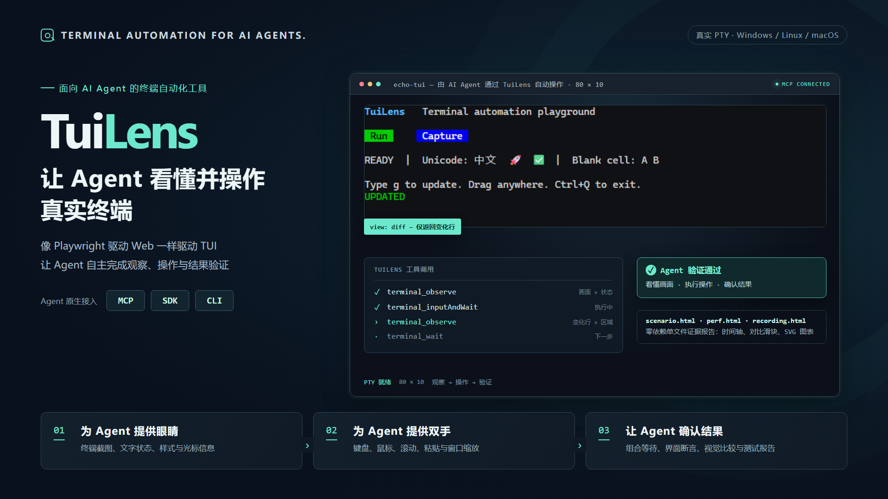

# TuiLens

**面向 AI Agent 的终端自动化工具。**

[English](README.md) · [简体中文](README.zh-CN.md) · [MIT 许可证](LICENSE)

TuiLens 在真实 PTY 中运行终端程序，通过 JSON CLI、MCP 和 TypeScript SDK
提供截图、终端状态、键盘与鼠标输入。



> **状态：** 0.6.0 实验版本。文本观察默认运行零浏览器 `TerminalCore`，
> 只有视觉产物才按需启动 Chromium。

[功能](#功能) · [安装](#安装) · [诊断](#诊断) · [快速开始](#快速开始) · [接口](#接口) · [证据报告](#证据报告) · [开发](#开发) · [文档](#文档) · [许可证](#许可证)

## 功能

- **原生图片：** 按需启用 SIXEL、iTerm2 OSC 1337 内联图片和有界 Kitty 子集，支持 Unicode 虚拟放置。
- **绘制后端：** 默认 `headless`。可显式请求 `dom`/`webgl` 立即启动浏览器；截图、图片协议和视觉比较会按需激活。每次会话都会返回实际 renderer。
- **视觉测试：** 字符格区域截图、PNG 比较、像素遮罩、差异图与报告。
- **输入操作：** 按键、括号粘贴、点击、按住/释放、拖拽、带位置滚轮和修饰键。
- **录制回放：** 有容量限制的输出/输入/resize 记录；离线回放不执行录制的输入。
- **可靠定位：** 区域和样式筛选、唯一/nth 匹配、帧或区域保护、组合条件等待。
- **交互确认：** `input-wait` 发送一次输入后等待可见结果，支持文本、尺寸、稳定和光标条件。
- **命中区控制：** `clickText` 可用 hitbox/point/offset 指定文字旁的真实可点击区域。
- **未提交帧点击：** 同步帧阻止正常定位时，可显式使用 `allowPendingFrame`。
- **滚动导航：** 滚轮支持按页单位和应用回滚区的首尾定位。
- **键盘协议：** 除传统 xterm 编码外支持 Kitty keyboard protocol（`CSI u`）与 `modifyOtherKeys`，
  使 `Shift+Enter`、`Ctrl+Enter`、`Ctrl+Space` 能送达已协商这些协议的应用。
- **终端能力画像：** 内置 preset 或派生 JSON profile 统一驱动 `TERM`、DA1/DA2/XTVERSION/Kitty 查询应答、
  图片协议、键盘能力元数据和回滚缓冲；场景/性能测试可运行 profile 矩阵。
- **回滚区断言：** `observe.scrollback` 返回视口上方的历史行，滚出屏幕的内容仍可断言。
- **声明式观察：** `observe --view compact|full|cells|diff` 选择返回结构；`diff --from-frame` 仅返回变化行和元数据。截图需显式开启，`watch` 以 JSONL 流式输出紧凑帧。
- **引擎侧探测：** 区域文本/样式等待在浏览器终端内判断，只有命中后才传输轻量快照。
- **终端应答护栏：** 默认丢弃超时或无查询匹配的 DA1/DA2、CPR/DSR 等自动应答；`suppress` 保留普通输入。
- **场景执行：** 声明式步骤、失败截图、报告和自动清理。
- **性能测试：** 多轮声明式场景，支持历史增长准备、进程树内存采样、可选基线文件与劣化判定。
- **证据报告：** 统一 scenario/perf/recording Evidence Bundle，生成零外部依赖单文件 HTML，
  包含时间轴、对比滑块、SVG 图表、矩阵标签页与有界图片内联。
- **断言层：** playwright 风格的 `Terminal` 句柄，失败时给出期望/实际/截图，并可输出 JUnit XML。
- **本地诊断：** `doctor` 检查运行时、浏览器、`node-pty`、存储和 daemon 状态，不启动 daemon。
- **渲染指纹：** `probe` 渲染固定字形样本，报告字符度量、renderer 与稳定的字体/网格指纹。
- **隔离选项：** `TUILENS_PTY_WORKER=1` 会为每个会话在子进程加载 `node-pty`；默认仍走进程内快速路径。
- **Agent 接口：** CLI/MCP 共用接口，同时提供 SDK。

## 环境要求

- Node.js **22 或更高版本**。
- Windows、Linux 或 macOS（实验性）。
- 纯文本会话**不需要浏览器**；截图与图片协议需要本机 Chrome、Edge 或 Chromium
  （也可以安装 Playwright Chromium）。
- node-pty 无可用预编译包时，需要相应平台的 C++ 构建工具。

## 安装

安装 npm 包并验证运行环境：

```sh
npm install -g tuilens
tuilens doctor
```

不想全局安装时可直接使用：

```sh
npx -y tuilens doctor
npx -y tuilens mcp
```

pnpm 10+ 默认阻止依赖运行构建脚本，安装后需要批准 `node-pty`：

```sh
pnpm add -g tuilens
pnpm approve-builds -g
```

在提示中选择 `node-pty`。项目内安装时，在该项目的 pnpm 构建策略中允许同一包，或在项目目录运行
`pnpm approve-builds`。

使用 npm 12+ 将 TuiLens 安装为依赖时，需要在消费项目允许 `node-pty` 的原生安装脚本：

```json
"allowScripts": { "node-pty@1.2.0-beta.18": true }
```

纯文本会话现在即可使用。截图或图片协议会优先查找系统 Chrome/Edge/Chromium；没有时再安装：

```sh
npx playwright-core install chromium
```

通过 `TUILENS_BROWSER_PATH` 指定浏览器。

### 从源码开发

只有开发 TuiLens 本身时才需要源码流程：

```sh
git clone https://github.com/Blackn-L/TuiLens.git
cd TuiLens
npm ci
npm run build
node dist/src/interfaces/cli.js doctor
```

源码仓库通过 `node dist/src/interfaces/cli.js` 提供同一组命令；日常使用以发布的 `tuilens`
可执行文件为准。

## 诊断

运行本地诊断：

```sh
tuilens doctor
tuilens probe
```

它会检查 Node.js 与平台支持、浏览器发现、`node-pty`、存储权限和 daemon 状态，
但不会启动 daemon。存在错误级检查时退出码为 1；陈旧 daemon 元数据等警告不会使命令失败。

通过 `TUILENS_FONT_FILE` 指定 `.ttf`、`.otf`、`.woff` 或 `.woff2` 文件，可固定截图字体；
`TUILENS_FONT_FAMILY` 可覆盖回退字体栈。修改后需重启 daemon。内嵌字体会在
`snapshot.render.fontHash` 中留下标识；`probe --font-file <路径> --strict-font` 会检查圈码字阶是否一致。
默认渲染会注入只覆盖圈码的本地字面：`Noto Sans`、`MS PGothic`、`Segoe UI Symbol` 和
`Apple Symbols`，避免 Windows 把 `⓪` 和 `⑪`–`⑳` 悄悄交给 Consolas 的小字形，同时不影响主 ASCII/CJK 字体选择。

设置 `TUILENS_LANG=zh-CN` 可输出中文消息。

## 快速开始

先查看 CLI 帮助：

```sh
tuilens --help
```

然后从仓库根目录运行独立场景：

```sh
tuilens scenario --file examples/scenario.json
```

JSON 结果包含报告路径和步骤证据。场景或视觉比较失败时退出码为 1。

启动交互会话：

```sh
tuilens launch --record --cols 80 --rows 16 -- node examples/echo-tui.mjs
```

用 `--terminal-profile kitty`、`wezterm`、`iterm2` 或 JSON profile 路径选择终端身份。
全部 preset、继承方式和矩阵示例见[终端能力画像](docs/zh-CN/PROFILES.md)。

将返回的 `data.id` 替换到下面的 `SESSION_ID`：

```sh
tuilens observe SESSION_ID
tuilens type SESSION_ID g
tuilens wait SESSION_ID --text UPDATED
tuilens input-wait SESSION_ID PING --text INPUT_RECEIVED
tuilens drag SESSION_ID 2 3 20 3 --shift
tuilens observe SESSION_ID --region 0,7,30,4
tuilens key SESSION_ID Ctrl+q
tuilens wait SESSION_ID --exited
tuilens close SESSION_ID
tuilens shutdown
```

坐标从 **0** 起算，单位为字符格。普通输入返回表示已送达；需要确认渲染结果时使用
`input-wait` 或显式等待。它不会自动重发输入。
终端自动应答默认使用 `--protocol-replies auto`，只转发及时且存在查询匹配的已知应答。
若应用在 TTY 已回显时查询，使用 `--protocol-replies suppress` 或应用侧探测开关。

## MCP 接入

用 `mcp-config` 生成客户端配置，不必手写路径：

```sh
tuilens mcp-config --client codex
tuilens mcp-config --client json --mode absolute
tuilens mcp-config --client claude-code --mode npx
```

客户端可选 `json`、`codex`、`claude-code`、`cursor`、`gemini`；模式可选 `global`
（已安装 `tuilens`）、`npx`（免全局安装）和 `absolute`（当前 `process.execPath` 加已安装
`cli.js`，适合不继承 shell `PATH` 的 GUI 客户端）。

MCP 服务提供 launch/observe/input/wait/compare/scenario/perf 工具，只读
`tuilens://` 会话/画面/截图/metrics/artifact 资源，以及 `tui_reproduce_bug`、
`tui_visual_regression` 两个 Prompt。推荐主循环：
`terminal_launch` -> `terminal_observe(view:"compact")` -> `terminal_inputAndWait` ->
`terminal_observe(view:"diff",fromFrameId:<上一次 frameId>)`；截图必须显式开启。

Codex、Claude Code、Cursor、Gemini CLI 配置、验收、排错和本机安全说明见
[MCP 接入指南](docs/zh-CN/MCP-SETUP.md)。

## 接口

所有接口共用同一套 PTY 引擎和会话状态。按调用方需要选择最小接口。

| 接口 | 适用场景 | 入口 | 详情 |
| --- | --- | --- | --- |
| CLI | Shell 脚本、CI 任务和手动探测 | `tuilens <command>` 或 `npx -y tuilens <command>` | [快速开始](#快速开始) · [协议示例](docs/zh-CN/PROTOCOL.md) |
| MCP | 需要工具、资源和 Prompt 的 Agent | 通过 stdio 启动 `tuilens mcp`（用 `mcp-config` 生成配置） | [MCP 接入指南](docs/zh-CN/MCP-SETUP.md) |
| TypeScript SDK | 测试套件和内嵌自动化 | `import { SessionManager, terminal } from "./dist/src/index.js"` | [测试断言](#测试断言) · [SDK 示例](#typescript-sdk) |

## 语言

CLI 帮助、MCP 工具描述、错误和断言信息默认使用英文。设置 `TUILENS_LANG=zh-CN`
可切换到简体中文：

```powershell
$env:TUILENS_LANG = "zh-CN"
```

```sh
export TUILENS_LANG=zh-CN
```

`TUILENS_LANG` 对大小写不敏感，接受 `en`、`zh` 和 `zh-CN`；不支持的值会回退到英文。
使用 MCP 时，可在客户端的环境变量中设置该值，使该连接的工具描述和错误响应使用中文。
CLI、MCP 和 SDK 的结构化错误同时提供 `messageEn` 与 `messageZh`，`message` 跟随当前语言。

## 图片与截图

图片协议由终端 profile 能力声明。可使用 `launch --terminal-profile kitty` 等预设，
或在 JSON 启动参数中显式提供 `graphics`：

```json
{ "command": "my-tui", "graphics": { "sixel": true, "kitty": true, "iterm": true } }
```

图片默认关闭。这些开关只启用已实现的协议子集，不代表完整 Kitty 或 OSC 1337 扩展兼容。
启用任一图片协议会激活 `VisualRenderer`。

`launch --renderer webgl` 会立即启用 xterm.js WebGL 绘制；默认 `headless`。普通不带截图的
`observe` 不会启动 Chromium。需要在截图中保证块字符/框线连续时建议使用 WebGL。
它可能把字符格宽取整（例如 160 列从 1500px 变为 1440px），切换后应重新录制视觉基准。
`session.renderer`、scenario/perf 环境、观察 JSON 和比较 JSON 记录实时 renderer；
录制头记录录制开始时的 renderer。
WebGL 无法启动时会回退 DOM 并回传 `dom`，不会静默声称使用了 WebGL。会话可以从 `headless`
开始，在首次截图后返回 `dom`；若有界回放窗口丢弃了重建画面所需历史，会设置 `visualSyncDegraded`。

```sh
tuilens observe SESSION_ID --screenshot --region 0,0,40,10
tuilens observe SESSION_ID --view cells
tuilens observe SESSION_ID --view diff --from-frame 42
tuilens compare SESSION_ID --baseline baseline.png --region 0,0,40,10
```

截图和状态共享 `frameId`。区域裁剪只改变 PNG，状态仍包含完整视口。
`compact` 为默认值；`full` 跳过 compact 行尾裁剪，`cells` 额外返回完整字符格，
`diff` 与最近 16 帧中的一个轻量快照比较。完整截图元数据也保存在本地。
基准图只读，接受新基准必须显式复制已审查的截图。
比较遮罩以 **PNG 像素**计量，与字符格坐标不同。请固定字体、浏览器和网格以解释像素差异。

详见[图片支持](docs/zh-CN/IMAGES.md)和[视觉比较](docs/zh-CN/VISUAL.md)。

## 定位与等待

```sh
tuilens find SESSION_ID Run --unique
tuilens click-text SESSION_ID Run --nth 1
tuilens click-text --json '{"id":"SESSION_ID","text":"Collapse","options":{"hitbox":{"right":3},"point":"right"}}'
tuilens wait SESSION_ID --stable 250 --region 0,0,40,10
```

`click-text` 默认要求唯一匹配；发现文字不等于识别业务按钮。
可用 `hitbox`/`point`/`offset` 扩展命中区或选择文字右侧的箭头，并可指定鼠标按钮。
JSON 接口还支持 `style`、`count`、`afterFrameId` 和输入保护条件。
区域指纹可阻止对已变化目标的操作，同时容许其他区域继续动画。
同步帧始终不结束时，可在 `clickText` 的 `options.allowPendingFrame:true` 显式放宽同步帧读取。
它读取未提交的字符缓冲，仍校验目标区域指纹；不提供稳定 PNG，也不绕过 `frameId` 保护。
普通观察与截图仍要求同步帧结束。

```json
{ "type": "scroll", "x": 20, "y": 10, "direction": "down", "unit": "page", "amount": 5 }
{ "type": "scroll", "x": 20, "y": 10, "to": "top" }
```

滚动坐标选择应用中的悬停区域。按页滚动按终端行数展开；首尾导航使用有界滚轮事件序列，
仍受应用消费方式和回滚区容量限制。单次 `amount` 上限为 100；需要拖动滚动条时使用显式 drag。

所有命令均可通过 `--json`、`--file` 或 `--stdin` 传入结构化参数。
详见[协议示例](docs/zh-CN/PROTOCOL.md)。

## 录制与场景

`launch --record` 从第一批已处理输出开始记录，返回 `recordingPath`。
录制包含终端正文与输入内容，启用前应考虑会话数据。
默认上限 16 MiB，可配置 4 KiB–64 MiB，达到上限会明确标注截断。

```sh
tuilens replay path/to/session.recording.jsonl
tuilens replay path/to/session.recording.jsonl --speed 2
```

回放只将输出和 resize 应用到新引擎，不重新运行程序、命令或输入。
`speed=0` 表示立即应用；截断回放需要显式设置 `--allow-truncated`。

[场景示例](examples/scenario.json) · [录制与场景规则](docs/zh-CN/RECORDING.md)

## 性能测试

TUI agent 会不断积累会话历史，响应时间往往随会话变长而劣化。
`perf` 用固定工作负载跑多轮（每轮重启被测程序），可与**你自己生成的基线**比较。
TuiLens 仓库不提交基线：测量结果依赖被测程序、平台、网格和 runner。

```sh
# 为你的工作负载生成基线，路径由你决定。
tuilens perf --file examples/perf.json --write-baseline artifacts/perf-baseline.json

# 后续运行与基线比较。
tuilens perf --file examples/perf.json \
  --baseline artifacts/perf-baseline.json --max-regression 0.15 --junit artifacts/junit-perf.xml
```

要在自己的仓库里用基线做 CI 门禁，请改用受版本控制的路径；`artifacts/` 只用于本地或演示运行，
不会被 Git 跟踪。

每轮都重新启动被测程序，进程内状态不会跨轮次泄漏。每个采样都是「输入发出 → 证据可见」，
也就是用户真实感受到的延迟。`setup` 在测量前重建状态（例如 40 轮历史），
`{{seq}}` 会展开为本次运行内的输入序号，确保每次采样等待的是**它自己**产生的新证据，
而不是屏幕上早已存在的文本。

```json
{
  "version": 1,
  "launch": { "command": "node", "args": ["examples/perf-tui.mjs"], "cols": 80, "rows": 24 },
  "ready": [{ "kind": "text", "text": "TURN_0" }],
  "warmupRounds": 1, "rounds": 3, "repeats": 3,
  "phases": [{
    "name": "short-history",
    "samples": [{ "input": { "type": "text", "text": "x" },
      "observe": [{ "kind": "text", "text": "TURN_{{seq}}" }] }]
  }]
}
```

结果包含各阶段的 p50/p95/p99、抖动分级（max ÷ p50）、**被测程序进程树**的内存峰值
（不只是工具自身），以及提供基线时每个指标相对基线的变化。提供基线时，p50 超过
`--max-regression` 会以非零退出码失败。

基线是可选测量快照，不是必需配置。它记录平台与网格；环境不一致时默认拒绝比较，
确需比较时使用 `--allow-env-mismatch`。测量边界见[性能文档](docs/zh-CN/PERFORMANCE.md)。

## 证据报告

scenario、perf 与 recording 可统一生成一份离线 HTML，不依赖 CDN、外部字体或网络请求：

```sh
tuilens scenario --file examples/scenario.json --html artifacts/scenario.html
tuilens perf --file examples/perf.json --html artifacts/perf.html
tuilens report artifacts/perf-....json --out perf-report.html
tuilens report artifacts/session.recording.jsonl --out recording-report.html
```

Scenario 报告包含步骤时间轴、失败截图与基准/实际对比滑块；性能报告包含 p50/p95/p99、
stability、启动耗时、进程树 RSS、SVG 延迟柱状图、RSS 时间线与基线回归；录制报告提供可拖动
离线时间轴以及 resize/exit 元信息。内嵌 `EvidenceManifest` 显式登记所有 artifact。

所有文本都会转义，内嵌 JSON 可安全出现在 `<script>` 中。单图最多内联 8 MiB，全部图片共享
24 MiB 预算；超限时降级为路径和体积。详见[证据报告](docs/zh-CN/REPORTING.md)。

## 测试断言

SDK 提供接近 playwright 的句柄：

```ts
import { SessionManager, terminal } from "./dist/src/index.js";

const manager = new SessionManager({ artifactDir: "./artifacts" });
const tui = await terminal(manager, { command: "my-tui", cols: 100, rows: 30 });
await tui.expectText("Ready");
await tui.type("hello");
await tui.key("Shift+Enter");           // 需要应用已协商 CSI u
await tui.expectText("Response", { timeoutMs: 10_000 });
await tui.expectNoText("Error", { timeoutMs: 500 });
```

`expectNoText` 会等满整个窗口才判定通过：只是还没渲染出来的文本不能被当成「不存在」。
断言失败会带上期望、实际、截图路径与画面摘录。

场景与性能运行都可以用 `--junit <路径>` 输出 JUnit XML，供 CI 展示。

## MCP

用 `tuilens mcp-config` 直接生成客户端格式：

```sh
tuilens mcp-config --client codex
tuilens mcp-config --client claude-code
tuilens mcp-config --client json --mode absolute
tuilens mcp-config --client cursor --mode npx
```

`--mode global` 假定 `tuilens` 已在 `PATH` 中；`--mode npx` 输出
`npx -y tuilens mcp`；GUI 客户端不继承 shell `PATH` 时使用 `--mode absolute`，
它会输出当前 Node 可执行文件和已安装的 `cli.js` 绝对路径。

Codex、Claude Code、Cursor、Gemini CLI 配置、验收、排错和本机安全说明见
[MCP 接入指南](docs/zh-CN/MCP-SETUP.md)。

MCP 服务还会在初始化时返回 `instructions`，提示 Agent 在交互式 TUI 任务中优先使用
TuiLens，并配合面向使用意图的工具描述。支持 server instructions 的客户端会自动读取；
如果某个 Agent 仍然不能稳定选择，再为它增加客户端级规则或 Skill。

工具包括 `terminal_launch`、`terminal_list`、`terminal_observe`、`terminal_find`、
`terminal_clickText`、`terminal_input`、`terminal_inputAndWait`、`terminal_resize`、`terminal_wait`、`terminal_compare`、
`terminal_replay`、`terminal_scenario`、`terminal_perf`、`terminal_metrics`、`terminal_close`。
观察、回放和启用截图的 inputAndWait 返回 PNG image content 和文字元数据；MCP 断开时回收该连接创建的会话。
客户端请求 progress token 时，wait、inputAndWait、replay、scenario 和 perf 会转发真实服务端进度；
取消 MCP 请求会中止对应的 daemon 操作。

只读资源：

- `tuilens://sessions`：安全会话元数据。
- `tuilens://sessions/{id}/screen`：无浏览器读取的 compact 文本。
- `tuilens://sessions/{id}/screenshot`：按需截取的 PNG。
- `tuilens://sessions/{id}/metrics`：背压与协议计数。
- `tuilens://artifacts/{name}`：16 MiB 上限，严格防路径穿越与符号链接逃逸。

Prompt：`tui_reproduce_bug`、`tui_visual_regression`（英文，或设置
`TUILENS_LANG=zh-CN` 使用中文）。

## TypeScript SDK

```ts
import { SessionManager } from "./dist/src/index.js";

const manager = new SessionManager({ artifactDir: "./artifacts", ptyWorker: false });
try {
  const session = await manager.launch({
    command: "node", args: ["examples/echo-tui.mjs"], cols: 80, rows: 16,
  });
  await manager.wait(session.id, { conditions: [{ kind: "text", text: "READY" }] });
  await manager.input(session.id, { type: "text", text: "g" });
  await manager.wait(session.id, { conditions: [{ kind: "text", text: "UPDATED" }] });
  console.log((await manager.observe(session.id)).screenshot?.path);
} finally {
  await manager.closeAll();
}
```

## 开发

```sh
npm run check
npm run lint
npm run format:check
npm test
npm run test:coverage
npm run smoke:install
npm run soak
npm run benchmark:overhead -- --frames 120 --repeats 3 --pace-ms 1
```

测试使用独立夹具，截图、录制、报告与编译产物均被 Git 忽略。
后台服务在 Windows 使用本机命名管道、Linux 使用 abstract Unix socket、macOS 使用私有 Unix socket，并使用本地令牌认证。
IPC v2 使用持久连接，一次鉴权后多路复用请求，并推送 `watch` 画面与真实长任务进度；
单连接在途请求上限为 64。
`TUILENS_IPC_TIMEOUT_MS` 可设置 IPC 超时；默认不施加固定五分钟上限。
`TUILENS_HOME` 可隔离状态目录，默认 `~/.tuilens`；没有公开 HTTP 控制端口。

## 文档

| 主题 | 简体中文 | English |
| --- | --- | --- |
| 架构 | [架构](docs/zh-CN/ARCHITECTURE.md) | [ARCHITECTURE.md](docs/ARCHITECTURE.md) |
| MCP 接入 | [MCP 接入](docs/zh-CN/MCP-SETUP.md) | [MCP-SETUP.md](docs/MCP-SETUP.md) |
| 协议 | [协议示例](docs/zh-CN/PROTOCOL.md) | [PROTOCOL.md](docs/PROTOCOL.md) |
| 终端能力画像 | [终端能力画像](docs/zh-CN/PROFILES.md) | [PROFILES.md](docs/PROFILES.md) |
| 录制与场景 | [录制与场景](docs/zh-CN/RECORDING.md) | [RECORDING.md](docs/RECORDING.md) |
| 证据报告 | [证据报告](docs/zh-CN/REPORTING.md) | [REPORTING.md](docs/REPORTING.md) |
| 图片支持 | [图片支持](docs/zh-CN/IMAGES.md) | [IMAGES.md](docs/IMAGES.md) |
| 视觉比较 | [视觉比较](docs/zh-CN/VISUAL.md) | [VISUAL.md](docs/VISUAL.md) |
| 验证 | [验证](docs/zh-CN/VALIDATION.md) | [VALIDATION.md](docs/VALIDATION.md) |
| 性能 | [性能](docs/zh-CN/PERFORMANCE.md) | [PERFORMANCE.md](docs/PERFORMANCE.md) |
| 发布 | [发布](docs/zh-CN/RELEASING.md) | [RELEASING.md](docs/RELEASING.md) |
| 路线 | [路线](docs/zh-CN/ROADMAP.md) | [ROADMAP.md](docs/ROADMAP.md) |

## 限制

- Kitty 为明确列出的子集，不支持外部文件/共享内存、动画、压缩和任意图层。
- 鼠标要求字符格 SGR 模式；系统输入法候选窗与系统剪贴板不属于当前渲染器。
- 截图默认隐藏光标本体；快照仍返回可见性、样式和闪烁状态，但无法验证真实宿主光标或 IME。
- `protocolReplies: "auto"` 只为及时且有查询匹配的已知自动应答放行；`suppress` 只丢弃完整已知应答，不过滤任意输入。若应用在 TTY 已回显时查询，仍需 `suppress` 或应用侧开关。
- 浏览器解析、绘制、截图和录制都有开销；轻量 metrics 不消除渲染成本。
- `doctor` 只检查模块加载、路径和 daemon 元数据，不会启动浏览器或 PTY；运行时验证仍需真实会话和测试套件。
- `watch` 默认只读；`--control` 会转发终端输入并要求交互式 TTY。`probe` 只代表当前字体、浏览器和平台组合。
- `TUILENS_PTY_WORKER=1` 增加一次 IPC 转发，不等同于安全沙箱。
- 输出回放不等同于应用重跑；区域稳定不证明所有后台工作结束。
- Windows node-pty 1.2.0-beta.18 清理期间可能输出 `AttachConsole failed`，需确认进程退出并保留诊断。

## 许可证

本项目采用 [MIT 许可证](LICENSE) 开源；版权所有 (c) 2026 Blackn-L。

第三方组件保留各自的上游许可证，见 [THIRD_PARTY.md](THIRD_PARTY.md)。

## 贡献

请阅读[贡献说明](docs/zh-CN/CONTRIBUTING.md)，提交独立复现与验证证据。
安全报告见 [SECURITY.md](SECURITY.md)。
