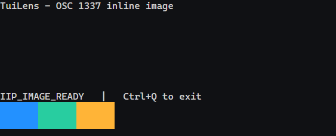

# Image support and region capture

[English](IMAGES.md) · [简体中文](zh-CN/IMAGES.md)

`launch.images` is `off` (default), `sixel`, `iterm`, or `all`.
`all` enables SIXEL, iTerm2 IIP, and the Kitty subset below, not every extension of these protocols.
Only enabled capabilities are advertised. Character pixel dimensions come from the actual terminal canvas.

## SIXEL

Uses `@xterm/addon-image 0.9.0`; initialization waits for the public image-query readiness probe.
SIXEL capability is advertised via DA1 attribute 4. Writes await parsing; screenshots await rendering.
Limits: 4M pixels per image, 8 MiB per sequence, 32 MiB cache.
Scrolling and text overwrite follow the addon's cell model; cursor policies may differ from other terminals.

## iTerm2 inline images (OSC 1337)

```sh
node dist/src/interfaces/cli.js launch --images iterm --cols 60 --rows 12 -- node examples/osc1337.mjs
```



`iterm` enables this family alone and does not advertise SIXEL or pretend to be iTerm2.
The protocol is associated with iTerm2, but can be decoded on any supported host OS.
The implementation reuses the image addon's decoding/storage and normalizes the input stream:

- `OSC 1337;File=...:base64 BEL`, with `ESC \` (ST) also accepted. C1 OSC/ST code points pass through the same validation.
- `MultipartFile=...`, `FilePart=...`, `FileEnd`; split terminal writes are also supported.
- `inline=1`, optional base64 `name`, optional `size`, `width`, `height`, and `preserveAspectRatio`.
- Dimensions in cells, pixels (`px`), viewport percentages (`%`), or `auto`.
- PNG, JPEG, and a static first frame from GIF. PNG is restricted to non-interlaced 8-bit images.
- Missing `size` is filled from decoded bytes. A declared size smaller than the actual file is rejected.
- When both dimensions are explicit and aspect ratio is preserved, the image fits within both bounds.

The file limit is 8 MiB decoded, header limit 8 KiB, field limit 1024 characters, multipart part limit 16384,
image size below 4M pixels with maximum side 4096. IIP and SIXEL share a 32 MiB cache.
Malformed or unsupported image requests are consumed without downloading files or invoking OSC side effects.
PNG containers are checked before decode; JPEG/GIF receive a bounded browser preflight before plugin rendering.
The plugin performs its own second decode; browser/process timeouts remain the final failure boundary.

Downloads (`inline=0`), APNG animation, native macOS formats such as PDF/PICT, shell integration,
clipboard actions and feature-reporting extensions are not implemented.
The usual wire form is the 7-bit `ESC ]` sequence. GIF animation is not played.
Images follow the addon's cell-based scrolling/erase policy; after resize, fractional cell widths
may cause a one-pixel outward rounding when stored images rescale.
Enabling the protocol is explicit; TuiLens does not set `TERM_PROGRAM=iTerm.app`.

## Kitty subset

The browser adapter supports:

- Inline `t=d`; PNG `f=100`, RGB `f=24`, RGBA `f=32`.
- Transfer `a=t`, transfer-and-place `a=T`, place `a=p`, query `a=q`.
- Chunked `m=1/0` transfer, including APC sequences split across writes.
- Explicit IDs, updates, deletion `d=i/I/a/A`, and quiet modes `q=0/1/2`.
- Direct cell-rectangle placement and cursor preservation with `C=1`.
- `U=1` virtual placement with foreground-encoded IDs and Unicode row/column placeholders.
- Virtual image tiles following buffer scrolling and text occlusion.

Virtual placement supports only `p=0` and preserves aspect ratio. Display-only placeholder suppression
prevents missing-glyph boxes while preserving the terminal buffer.
Direct placement uses line markers and content invalidation. EL 0/1/2 applies only to intersecting cells.
Same-content redraw, complex scrolling regions and full layering semantics are not guaranteed;
prefer virtual placement or explicit delete/reposition where appropriate.

Unsupported: file/shared-memory transport, compression, animation/APNG, crop, arbitrary z layers,
relative placement, automatic IDs, and nonzero virtual placement IDs. Unsupported requests return protocol errors unless silenced.

Independent bounds apply before allocation: 4M pixels and 4096 pixels per side; 32 MiB bitmap cache;
128 images; 256 placements; 65536 cumulative declared placement cells, including offscreen cells.
PNG container/CRC validation precedes browser decoding. Old images are evicted when the cache fills.

## Capture

```json
{ "x": 2, "y": 1, "width": 10, "height": 4 }
```

`observe.region` uses zero-based cells and must fit the viewport. Pixel edges round outward using actual cell geometry.
PNG dimensions are taken from the resulting image. Text, SIXEL, IIP and Kitty layers are included.
The crop affects the PNG only; state can retain the entire viewport.

Generated-pattern tests verify pixels, capabilities, updates, deletion, virtual scrolling/occlusion, limits and crop geometry.
They do not certify complete protocol equivalence with every terminal host.
