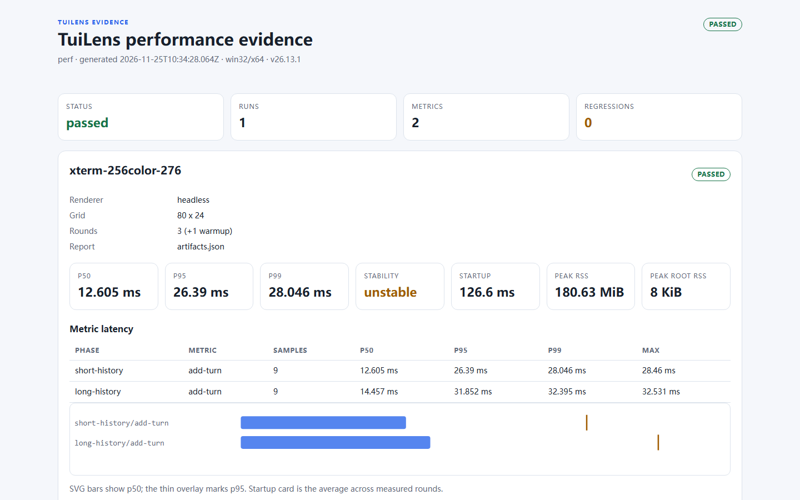

# Evidence reports

[English](REPORTING.md) · [简体中文](zh-CN/REPORTING.md)

TuiLens can turn scenario, performance and recording output into one self-contained HTML report.
The report is for debugging CI failures and sharing evidence; it never runs the recorded program or
recorded input.

## Evidence bundle

Every report embeds an `EvidenceManifest` version 1:

```json
{
  "version": 1,
  "kind": "scenario",
  "generatedAt": "2026-01-01T00:00:00.000Z",
  "environment": { "platform": "linux", "node": "v22.0.0", "arch": "x64" },
  "summary": { "pass": false, "steps": 9, "failures": 1 },
  "payloadPath": "/home/user/.tuilens/artifacts/scenario-....json",
  "artifacts": [
    {
      "role": "compare-diff",
      "path": "/home/user/.tuilens/artifacts/diff-....png",
      "mimeType": "image/png",
      "bytes": 12345,
      "stepIndex": 6
    }
  ]
}
```

Kinds are `scenario`, `scenario-matrix`, `perf`, `perf-matrix` and `recording`. Artifact roles make
the payload explicit instead of relying on filename conventions: reports, screenshots, failure
screenshots, compare baseline/actual/diff images, performance baselines and the source recording.

The manifest is embedded in the HTML as `application/json`. The SDK can also write it separately:

```ts
import {
  buildPerfEvidence,
  writeEvidenceManifest,
} from "tuilens";

const manifest = await buildPerfEvidence(result);
await writeEvidenceManifest("artifacts/evidence.json", manifest);
```

`writeEvidenceBundle(manifest, payload, directory)` writes a self-contained directory:
`payload.json`, `evidence.json`, and copied `artifacts/` files. Manifest artifact paths are rewritten
to relative paths inside that directory.
Recording bundles keep the parsed report in `payload.json` and the original replayable JSONL in `artifacts/`.

## CLI

Scenario and performance commands accept `--html`:

```sh
tuilens scenario --file examples/scenario.json --html artifacts/scenario.html
tuilens perf --file examples/perf.json --html artifacts/perf.html
tuilens perf --file examples/perf.json --baseline baseline.json \
  --html artifacts/perf-with-baseline.html
```

Existing JSON/JUnit output and exit codes are unchanged. HTML generation works for passing and
failing runs, so CI can archive the failure report.

Render an existing result or recording offline:

```sh
tuilens report artifacts/scenario-....json --out scenario-report.html
tuilens report artifacts/perf-....json --out perf-report.html
tuilens report artifacts/session.recording.jsonl --out recording-report.html
```

`report` does not start the daemon. It reads at most 64 MiB of JSON/JSONL.

## Report contents

- **Scenario:** pass/fail summary, matrix comparison, step timeline with action/condition details,
  elapsed time, errors, failure screenshot, and a baseline/actual slider plus diff image for compare
  steps.
- **Performance:** p50/p95/p99 and stability cards, startup time, process-tree peak RSS, SVG latency
  bars, an RSS timeline, baseline regression rows and matrix profile tabs.
- **Recording:** header renderer/grid/profile, resize and exit events, truncation warning, event
  inventory and a draggable offline timeline. ANSI is stripped in the browser; recorded input is
  never executed.



## Safety and bounds

- The HTML uses only inline CSS, JavaScript and SVG. It has no CDN, external font, external script or
  remote image request, and declares a restrictive Content-Security-Policy.
- All dynamic text is HTML-escaped. Embedded JSON replaces `<`, `>` and `&` with Unicode escapes, so
  a malicious `</script>` value cannot close the JSON block.
- A single image is inlined only when it is at most **8 MiB**; all inline images share a **24 MiB**
  budget. Larger or unreadable images fall back to their path and size without failing the report.
- Recording output embedded for replay is capped at 2 MiB. The event inventory is capped at 200 rows;
  the RSS timeline is capped at 512 points.

Reports are local artifacts. Review them before publishing if the terminal output contains secrets.
