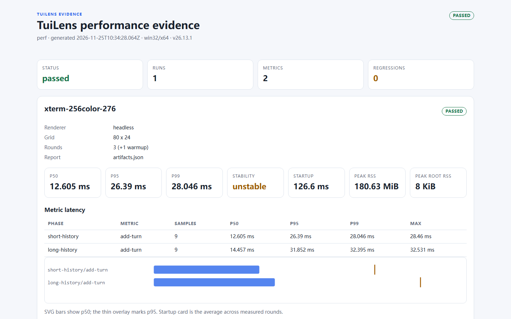

# 证据报告

[English](../REPORTING.md) · [简体中文](REPORTING.md)

TuiLens 可以把 scenario、perf 与 recording 输出统一渲染成一个自包含 HTML 报告，用于 CI 失败排查
和证据共享。报告不会重新运行被测程序，也不会执行录制的输入。

## Evidence Bundle

每份报告都内嵌 version 1 `EvidenceManifest`：

```json
{
  "version": 1,
  "kind": "scenario",
  "generatedAt": "2026-01-01T00:00:00.000Z",
  "environment": { "platform": "linux", "node": "v22.0.0", "arch": "x64" },
  "summary": { "pass": false, "steps": 9, "failures": 1 },
  "payloadPath": "/home/user/.tuilens/artifacts/scenario-....json",
  "artifacts": [
    {
      "role": "compare-diff",
      "path": "/home/user/.tuilens/artifacts/diff-....png",
      "mimeType": "image/png",
      "bytes": 12345,
      "stepIndex": 6
    }
  ]
}
```

kind 为 `scenario`、`scenario-matrix`、`perf`、`perf-matrix` 或 `recording`。artifact role 显式登记
报告、截图、失败截图、compare 基准/实际/差异图、性能基线和源录制，不依赖文件名猜测。

manifest 以 `application/json` 内嵌在 HTML 中，也可由 SDK 单独写出：

```ts
import {
  buildPerfEvidence,
  writeEvidenceManifest,
} from "tuilens";

const manifest = await buildPerfEvidence(result);
await writeEvidenceManifest("artifacts/evidence.json", manifest);
```

`writeEvidenceBundle(manifest, payload, directory)` 会写出自包含目录：`payload.json`、
`evidence.json` 和复制后的 `artifacts/` 文件；manifest 内的 artifact 路径会改写为目录内相对路径。
录制证据包的 `payload.json` 保存解析后的报告，`artifacts/` 保存可独立回放的原始 JSONL。

## CLI

scenario 与 perf 支持 `--html`：

```sh
tuilens scenario --file examples/scenario.json --html artifacts/scenario.html
tuilens perf --file examples/perf.json --html artifacts/perf.html
tuilens perf --file examples/perf.json --baseline baseline.json \
  --html artifacts/perf-with-baseline.html
```

原有 JSON/JUnit 输出和退出码保持不变。成功和失败运行都会生成 HTML，CI 可以归档失败报告。

已有结果或录制可离线生成：

```sh
tuilens report artifacts/scenario-....json --out scenario-report.html
tuilens report artifacts/perf-....json --out perf-report.html
tuilens report artifacts/session.recording.jsonl --out recording-report.html
```

`report` 不启动 daemon，JSON/JSONL 输入最多读取 64 MiB。

## 报告内容

- **Scenario：** 通过/失败总览、矩阵对比、包含动作/条件、耗时、错误的步骤时间轴、失败截图，
  以及 compare 步骤的基准/实际滑块和差异图。
- **Performance：** p50/p95/p99、stability、启动耗时、进程树峰值 RSS、SVG 延迟柱状图、
  RSS 时间线、基线回归表和矩阵 profile 标签页。
- **Recording：** header、renderer、网格、profile、resize 与 exit 事件、截断警告、事件清单，
  以及可拖动的离线时间轴。浏览器端会剥离 ANSI，录制输入永不执行。



## 安全与边界

- HTML 只使用内联 CSS、JavaScript 与 SVG，不请求 CDN、外部字体、外部脚本或远程图片，
  并声明严格 Content-Security-Policy。
- 所有动态文本都经过 HTML 转义；内嵌 JSON 会把 `<`、`>`、`&` 转成 Unicode 转义，
  恶意 `</script>` 无法闭合 JSON 块。
- 单图最多内联 **8 MiB**，全部内联图片共享 **24 MiB** 预算；超限或读取失败时降级为路径和
  体积提示，不会让整份报告失败。
- 录制回放文本最多嵌入 2 MiB；事件清单最多 200 行；RSS 时间线最多 512 点。

报告是本地 artifact。若终端输出包含敏感信息，发布前请先审查内容。
